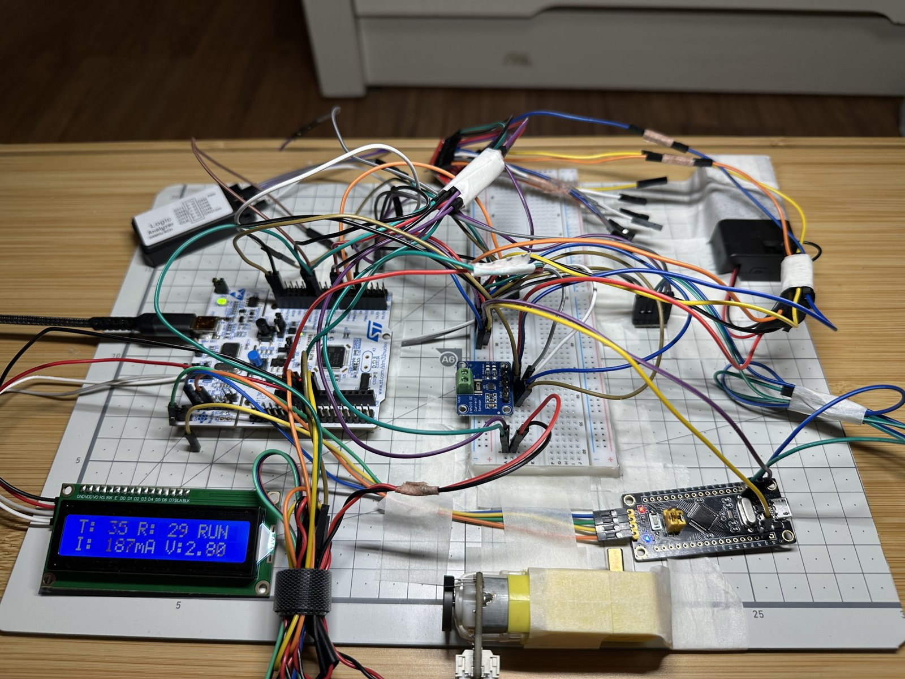
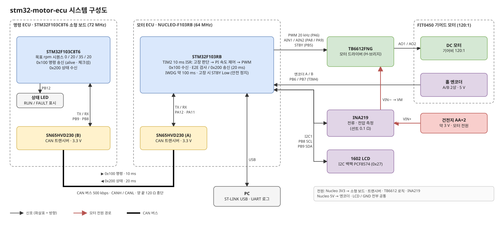
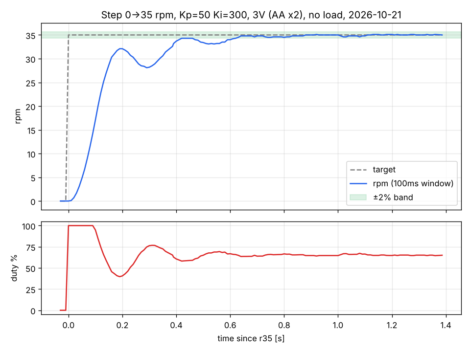

# stm32-motor-ecu

STM32 보드 두 개를 CAN으로 연결해서, 한 보드가 보낸 목표 속도대로 다른 보드가 모터를 돌리게 만든 프로젝트입니다.
통신이 끊기거나 모터가 걸리면 모터 쪽 보드가 알아서 멈추도록 했고, 일부러 고장을 내 보면서 정말 멈추는지 확인했습니다.



왼쪽이 모터를 돌리는 NUCLEO-F103RB, 오른쪽 아래가 명령을 보내는 STM32F103C8T6 소형 보드입니다. LCD에는 목표 속도, 상태, 전류가 나옵니다.



(구성도는 draw.io로 그렸고, 위 svg 파일을 draw.io에서 열면 바로 고칠 수 있습니다.)

## 만든 이유

STM32로 모터를 직접 돌려 보고, 보드 두 개끼리 CAN 통신을 해 보고 싶어서 시작했습니다.
보드 하나로도 모터는 돌릴 수 있지만, 자동차처럼 명령하는 제어기와 실제로 모터를 돌리는 제어기를 나누고 CAN으로 주고받는 구조를 작게나마 따라 해 보고 싶었습니다.

보드를 나누니까 자연스럽게 "통신이 끊기면 모터는 어떻게 해야 하지?"라는 문제가 생겼고, 이걸 해결하는 게 이 프로젝트의 절반 정도가 됐습니다.

원래는 명령 보드에 가변저항을 달아서 손잡이를 돌리면 모터 속도가 따라오게 하려고 했는데, 가변저항 모듈이 파손돼서 지금은 0 → 20 → 35 → 20 rpm을 3초씩 자동으로 반복해서 보내도록 했습니다.

## 구성

- 모터 보드: NUCLEO-F103RB. 엔코더로 속도를 읽어 PI 제어로 모터를 돌리고, 전류를 보고, 고장이면 모터를 멈춥니다.
- 명령 보드: STM32F103C8T6 소형 보드. 목표 속도를 보내고, 모터 보드 상태를 받아 LED로 보여 줍니다.
- 그 외 부품: TB6612FNG 모터 드라이버, FIT0450 엔코더 모터, SN65HVD230 CAN 트랜시버 2개, INA219 전류 센서, 1602 I2C LCD, 로직 분석기
- 모터 전원은 AA 건전지 2개(약 3 V)입니다.

### 핀 (NUCLEO-F103RB)

| 기능 | 핀 | 연결 |
|---|---|---|
| 모터 PWM (20 kHz) | PA6 (TIM3_CH1) | TB6612 PWMA |
| 모터 방향 | PA8 / PA9 | TB6612 AIN1 / AIN2 |
| 드라이버 STBY | PB5 | TB6612 STBY (고장 시 여기로 출력 차단) |
| 엔코더 A / B | PB6 / PB7 (TIM4 엔코더 모드) | FIT0450 |
| I2C SCL / SDA | PB8 / PB9 (I2C1 리맵) | INA219 (0x40), LCD (0x27) |
| CAN RX / TX | PA11 / PA12 | SN65HVD230 |
| 타이밍 측정용 | PB0 | 로직 분석기 |
| UART | PA2 / PA3, PB10(미러) | PC |

## 동작 방식

1 ms 타이머 인터럽트를 기준으로, 10 ms마다 고장 판단 → 엔코더 읽기 → PI 계산 → 모터 출력을 인터럽트 안에서 한 번에 돌립니다.
LCD, 전류 센서, 시리얼 출력은 I2C/UART 전송을 기다려야 해서 메인 루프에 뒀습니다.

LCD를 붙인 뒤 제어를 일부러 메인 루프로 옮겨서 비교해 봤는데, LCD 한 번 갱신하는 데 18 ms 정도가 걸려서 제어 주기가 28.6 ms까지 늘어나고 모터 속도가 22~45 rpm 사이를 왔다 갔다 했습니다. 인터럽트에 두면 10 ms를 정확히 지켰습니다. (`main.c`의 `CTRL_IN_ISR`로 두 방식을 바꿔 볼 수 있습니다.)

### CAN 메시지 (500 kbps)

| ID | 방향 | 주기 | 내용 |
|---|---|---|---|
| 0x100 | 명령 → 모터 | 10 ms | 목표 rpm(2바이트), 순번 0~15, 체크섬 |
| 0x200 | 모터 → 명령 | 20 ms | 실제 rpm, 전류(mA), 상태(정지/운전/고장), 고장 코드 |

체크섬은 `(B0 ^ B1 ^ B2) ^ 0xFF`입니다. 모터 보드는 길이, 체크섬, 순번이 이어지는지 확인하고 통과한 메시지만 씁니다.

### 고장이면 멈추는 조건

- 정상 0x100이 100 ms 동안 안 옴
- 체크섬/순번 오류가 3번 연속
- 전류가 380 mA를 200 ms 넘게 유지
- 듀티를 40% 넘게 주는데 300 ms 동안 엔코더가 거의 안 움직임
- 전류 센서 읽기 실패가 200 ms 넘게 이어짐
- 메인 루프가 멈추면 워치독(약 100 ms)이 칩을 리셋

고장이 나면 STBY를 내려서 모터 출력을 끊고, 고장 코드를 0x200에 실어 보냅니다. 통신이 다시 살아나도 목표 속도가 0이 되기 전까지는 다시 돌지 않게 했습니다.

## 결과

**속도 제어** (Kp 50, Ki 300, 0 → 35 rpm, 무부하)

- 0.13초 만에 목표 근처까지 올라가고, 넘치는 건 0.3 rpm 정도
- 이후 ±0.2 rpm 안에서 유지
- 제어 인터럽트 실행 시간은 약 24 µs



**고장 주입 시험** (7개 모두 통과)

| 한 일 | 결과 |
|---|---|
| 운전 중 CANH 선 뽑기 | 107.3 ms 뒤 정지 |
| 명령 보드 리셋 | 104.7 ms 뒤 정지 |
| 점퍼로 체크섬 일부러 틀리게 보내기 | 첫 오류 후 28.6 ms 뒤 정지 |
| 바퀴를 손으로 잡기 | 과전류로 약 200 ms 뒤 정지 |
| 엔코더 전원 선 뽑기 | 약 570 ms 뒤 정지 |
| 메인 루프를 일부러 멈추기 | 워치독 리셋 후 `reset by watchdog` 출력 |
| 고장 중에 통신 복구 | 목표가 0이 될 때까지 안 돎 |

시간은 로직 분석기로 CAN 수신선과 STBY 핀을 같이 찍어서 쟀습니다.
과전류 기준은 처음에 600 mA로 잡았는데, 건전지 2개로는 바퀴를 잡아도 430 mA 정도밖에 안 나와서 안 걸렸습니다. 직접 잰 정상 최대값(315 mA)과 바퀴를 잡았을 때 값 사이인 380 mA로 다시 정했습니다.

자세한 측정값은 [`docs/measurements.md`](docs/measurements.md), 시험 기록은 [`docs/test_report.md`](docs/test_report.md), 요구사항은 [`docs/requirements.md`](docs/requirements.md)에 있습니다.

## 아쉬운 점

- 전원이 3 V라 모터 사양(6 V)보다 낮습니다. 최고 속도가 58 rpm 정도라서 목표를 35 rpm으로 잡았습니다. 전원을 바꾸면 과전류 기준도 다시 재야 합니다.
- 과전류 기준(380 mA)과 바퀴를 잡았을 때 전류(약 430 mA) 차이가 50 mA밖에 안 됩니다.
- 엔코더 고장은 300 ms 구간을 끊어서 보는 방식이라 최대 600 ms 가까이 걸립니다. 구간을 겹쳐 보면 줄일 수 있을 것 같습니다.
- CAN 선이 끊긴 동안에는 모터 보드가 고장 상태를 명령 보드에 알릴 방법이 없습니다.
- 전류 센서 고장 감지와 워치독 리셋 시간은 정밀하게 시험하지 못했습니다.

## 폴더

```
nucleo_motor_ecu/   모터 보드 (CubeMX + CMake)
bluepill_cmd_ecu/   명령 보드 (CubeMX + CMake)
docs/               측정값, 요구사항, 시험 기록, 사진, 캡처
```

## 개발 환경

STM32CubeMX, VS Code + CMake (arm-none-eabi-gcc), STM32CubeProgrammer, PulseView, C (HAL)
