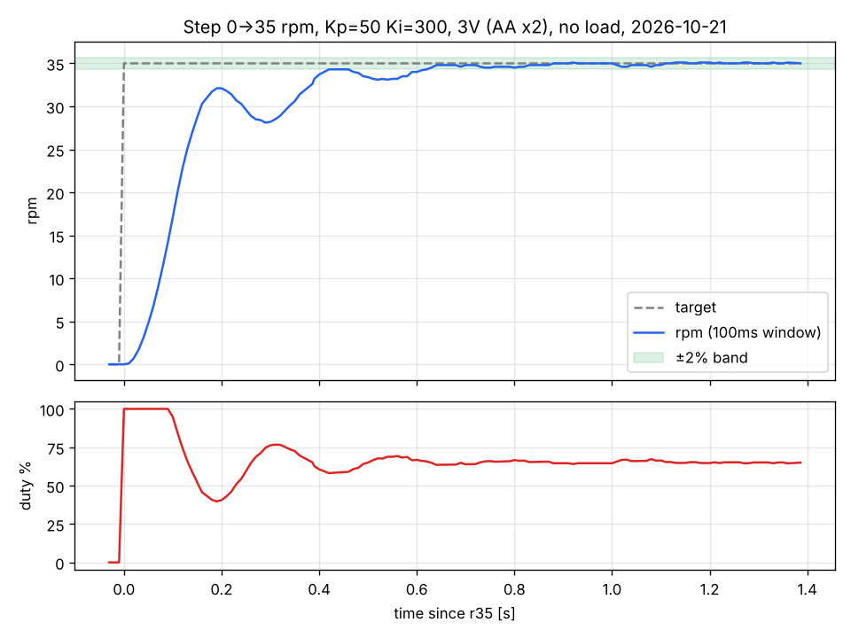

# stm32-motor-ecu

NUCLEO-F103RB로 만든 **모터 제어 ECU 미니 프로젝트**다. 엔코더 기반 PI 속도 제어, 2노드 CAN 통신(E2E 보호), 고장 감지와 안전 상태 전환을 구현하고, 요구사항 8개와 고장 주입 시험 7건으로 검증했다.

모든 수치는 직접 측정한 값이다(근거: [`docs/progress.md`](docs/progress.md) 측정값 표, [`docs/test_report.md`](docs/test_report.md)).

## 시스템 구성

```
 명령 ECU (STM32F103C8T6 소형 보드, 72 MHz)          모터 ECU (NUCLEO-F103RB, 64 MHz)
 ┌───────────────────────────┐                     ┌───────────────────────────────────────┐
 │ 목표 rpm 시퀀스 0/20/35/20 │  0x100 CMD 10 ms    │ CAN 수신 → E2E 검사(체크섬·alive)      │
 │ 0x100 송신 (alive, 체크섬) │ ─────────────────▶ │ TIM2 10 ms ISR: 고장 판단 → PI → PWM   │
 │ 0x200 수신 → LED 상태 표시 │ ◀───────────────── │ 0x200 STATUS 송신 (ISR, 20 ms)         │
 └────────────┬──────────────┘  0x200 STATUS 20 ms └──┬─────────┬──────────┬────────┬──────┘
              │ SN65HVD230                           │SN65HVD230│ TIM3 PWM │ TIM4   │ I2C1
              └──────── CAN 500 kbps (120 Ω 종단) ───┘          ▼          │ 엔코더  ├─ INA219 (전류)
                                                       TB6612FNG → DC 모터 ◀┘        └─ 1602 LCD
                                                       (AA×2, 약 3 V)
```

| 노드 | 보드 | 역할 |
|---|---|---|
| 모터 ECU | NUCLEO-F103RB | 엔코더 PI 속도 제어, 전류 감시, 고장 판단·안전 상태, IWDG |
| 명령 ECU | STM32F103C8T6 소형 보드 | 목표 속도 명령(0x100) 송신, 상태(0x200) 수신·LED 표시 |

## 핀 맵 (NUCLEO-F103RB)

| 기능 | MCU 핀 | 연결 |
|---|---|---|
| 모터 PWM 20 kHz | PA6 (TIM3_CH1) | TB6612 PWMA |
| 모터 방향 | PA8 / PA9 | TB6612 AIN1 / AIN2 |
| 드라이버 enable (안전 차단) | PB5 | TB6612 STBY |
| 엔코더 A / B (5 V, FT 핀) | PB6 / PB7 (TIM4 엔코더 모드) | FIT0450 엔코더 |
| I2C SCL / SDA (FT 핀) | PB8 / PB9 (I2C1 리맵) | INA219, LCD(PCF8574) |
| CAN RX / TX | PA11 / PA12 | SN65HVD230 CRX / CTX |
| 디버그 타이밍 | PB0 | 로직 분석기 |
| UART | PA2 / PA3 (USART2), PB10 (USART3 미러) | PC 로그 |

## CAN 메시지

| ID | 방향 | 주기 | 내용 |
|---|---|---|---|
| 0x100 CMD | 명령 ECU → 모터 ECU | 10 ms | B0–1 목표 rpm (uint16 LE) · B2 alive counter 0~15 · B3 체크섬 = (B0 ^ B1 ^ B2) ^ 0xFF |
| 0x200 STATUS | 모터 ECU → 명령 ECU | 20 ms | B0–1 실제 rpm (int16) · B2–3 전류 mA · B4 상태(0 STOP, 1 RUN, 2 FAULT) · B5 고장 코드 비트 |

비트 타이밍: 500 kbps, 샘플 포인트 87.5%(Nucleo) / 88.9%(소형 보드). 0x200 주기 실측 19.99~20.20 ms, 4.15 s 동안 208개 누락 0.

## 속도 제어 결과 (SR-01)

PI(Kp 50, Ki 300, 10 ms 주기, 조건부 적분 anti-windup), 0 → 35 rpm 스텝, 무부하, AA×2:

| 상승시간(10→90%) | 오버슈트 | 정상상태 오차 | ±2% 정착 | 제어 ISR 실행 시간 |
|---|---|---|---|---|
| 0.13 s | 0.3 rpm (0.9%) | ±0.2 rpm | 0.62 s | 약 24 µs (10 ms 중 0.24%) |



제어 루프를 TIM2 ISR에서 돌리는 이유를 실험으로 확인했다: LCD I2C 블로킹 중 main loop 실행 시 제어 주기가 28.6 ms(가끔 57.3 ms)로 늘어 rpm이 22.5~45.6으로 진동했고, ISR 실행 시 주기 10.026~10.029 ms로 rpm 35 유지.

## 고장 감지와 안전 상태

| 요구사항 | 감지 조건 | 동작 |
|---|---|---|
| SR-02 | 유효 0x100이 100 ms 없음 | STBY Low + 듀티 0, 고장 코드 래치 |
| SR-03 | 체크섬·alive 오류 3회 연속 | 〃 |
| SR-04 | 전류 > 380 mA가 200 ms 지속 | 〃 |
| SR-05 | 듀티 > 40%인데 300 ms 동안 카운트 변화 < 10 | 〃 |
| SR-06 | main loop 멈춤 (IWDG 약 100 ms) | 칩 리셋, 부팅 시 원인 출력 |
| SR-07 | (복귀 조건) 감지 중인 고장 없음 + 목표 0 | FAULT → STOP |
| SR-08 | INA219 읽기 실패 200 ms 지속 | STBY Low + 듀티 0 |

상세: [`docs/requirements.md`](docs/requirements.md)

## 고장 주입 시험 결과

| ID | 주입 | 결과 |
|---|---|---|
| FI-01 | CANH 선 분리 | 107.3 ms에 정지 |
| FI-02 | 명령 ECU 리셋 | 104.7 ms에 정지 |
| FI-03 | 체크섬 오염 | 첫 오염 프레임 후 28.6 ms에 정지 |
| FI-04 | 바퀴를 잡아 스톨 | 과전류로 약 200 ms에 정지 |
| FI-05 | 엔코더 전원 분리 | 약 570 ms에 정지 |
| FI-06 | main 무한 루프 | 워치독 리셋, `reset by watchdog` 출력 |
| FI-07 | 고장 중 통신 복구 | 목표 0 전까지 재가동 안 함 |

측정: 로직 분석기 12 MHz로 CAN(CRX)과 STBY를 동시에 캡처, 마지막 유효 프레임 → STBY 하강 간격. 상세와 시험 중 발견한 문제(과전류 임계값 600 → 380 mA 재설정 등): [`docs/test_report.md`](docs/test_report.md)

## 신호 캡처

| 대상 | 파일 |
|---|---|
| CAN 루프백 (0x123) | [`docs/captures/day08_can_loopback.png`](docs/captures/day08_can_loopback.png) |
| CAN 2노드 0x100 디코딩 | [`docs/captures/day09_can_0x100.png`](docs/captures/day09_can_0x100.png) |
| CAN 2노드 0x100/0x200 | [`docs/captures/day09_can_2node.png`](docs/captures/day09_can_2node.png) |
| 고장 주입 원본 (CAN 주석 + VCD) | `docs/captures/day10_fi0*.txt`, `.vcd` |

## 알려진 한계

- 모터 전원이 AA×2(약 3 V)라 사양(6 V)보다 낮다. 최고 속도 약 58 rpm, 스톨 전류 약 430 mA. 전원을 바꾸면 과전류 임계값을 다시 정해야 한다.
- 엔코더 고장 감지는 300 ms 고정 창이라 최대 약 600 ms 걸린다(슬라이딩 창으로 개선 가능).
- 과전류 임계값과 스톨 전류의 차이가 약 50 mA로 작다.
- CAN 버스가 끊긴 동안에는 FAULT 상태를 명령 ECU에 알릴 수 없다.
- 워치독 리셋 시간과 SR-08은 정밀 시험하지 않았다.
- MISRA C를 지향했지만 정적 분석 도구로 검사하지 않았다.

## 저장소 구조

```
stm32-motor-ecu/
├── nucleo_motor_ecu/     # 모터 ECU (CubeMX + CMake)
├── bluepill_cmd_ecu/     # 명령 ECU (CubeMX + CMake)
└── docs/
    ├── progress.md       # 진행 기록, 측정값
    ├── lab_guide.md      # 10일 실습 가이드
    ├── requirements.md   # 안전 요구사항 SR-01~08
    ├── test_report.md    # 고장 주입 시험 FI-01~07
    └── captures/         # 로직 분석기 캡처, 그래프
```

## 개발 환경

STM32CubeMX, VS Code + CMake(arm-none-eabi-gcc), STM32CubeProgrammer CLI, PulseView(sigrok), C(HAL).
